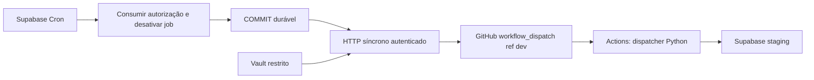

# Proposta 20261019: um disparo controlado por Supabase Cron

## Atualização — CRON_STAGING_TRANSACTIONAL_PROBE_RESUME

Em 19/10/2026, o humano aceitou a leitura dos estados exclusivamente sintéticos
por supabase_read_only_user/supabase_etl_admin, sem estender essa confiança a
tokens ou dados operacionais. Ambos têm LOGIN, BYPASSRLS e pg_read_all_data;
não receberam EXECUTE/UPDATE. Nenhum privilégio global foi alterado.
O probe PostgreSQL real passou: visibilidade independente antes/depois de
commit, rollback após erro deliberado, bloqueio concorrente com único vencedor,
replay e expiração. Controle desativado, evidência sintética preservada, baseline
9/11/8 antes/depois (deltas zero). Detalhes em run_log e
[evidência](../../drafts/cron_controlled_dispatch/probe/execution_20261019_sanitized.json).
GREEN é apenas transacional; pacote Cron/Edge permanece YELLOW. Próximo gate
CRON_EDGE_AUTHORIZATION_REDESIGN exige revisão própria, não iniciado aqui.

## Revisão vigente — CRON_STAGING_INACTIVE_PREPARATION_REVIEW

**YELLOW. Não implantar o pacote operacional, nem inativo.** A revisão abaixo
de preparação passa a ser histórico; os artefatos anteriores foram preservados.
Auditoria integral, fontes e correções pendentes em
[REVIEW.md](../../drafts/cron_controlled_dispatch/REVIEW.md).

Correção durável: não depender de REVOKE/RLS da fila pg_net no Supabase hospedado.
Grants pertencem a supabase_admin e a plataforma documenta que alterações por
projeto não são suportadas. Toda credencial enviada na fila é potencialmente
legível por qualquer LOGIN. Bearer global reutilizável e adapter service_role
amplo não estão aprovados. PAT continuará exclusivamente no secret store Edge;
propor capability por operação, expirada e consumida uma vez, e identidade DB
restrita, ainda a implementar/revisar. Uma capability vazada pode causar corrida
ou DoS da própria operação; não deve autorizar futuros dispatches.

A verificação pg_xact_status é redundante quando uma transação independente
comprova visibilidade de receipt/estado imutável confirmado. Não confundir ordem
de statements com COMMIT. Primeiro preparar prova mínima PostgreSQL, sem instalar
qualquer transporte: [probe isolado](../../drafts/cron_controlled_dispatch/probe/README.md).
Três conexões, schema novo privado, duas tabelas e funções invoker; testar locks,
rollback, visibilidade antes/depois, expiração/replay. Ainda não executado.

Cinco SQLs de setup/armamento e entrypoint Edge bloqueados explicitamente até
redesenho; rollback operacional permanece apenas rascunho de contingência.
Próxima aprovação: **APROVAR PROBE TRANSACIONAL ISOLADO EM STAGING**, sem
extensões, Cron, Edge, credenciais ou HTTP. Gate remoto anterior permanece GREEN.

## Histórico — CRON_CONTROLLED_DISPATCH_SQL_PREPARATION

**Status YELLOW; rascunhos preparados e testados offline, sem aplicação.**
O gate anterior automation_remote_runner_validated permanece GREEN.
Esta revisão substitui a recomendação de HTTP síncrono do diagnóstico abaixo,
preservado como histórico. Pacote revisável:
[drafts/cron_controlled_dispatch/README.md](../../drafts/cron_controlled_dispatch/README.md).

A revisão do pg_cron 1.6.4 confirmou que um comando CALL isolado é enviado por
libpq como consulta top-level. PostgreSQL permite COMMIT verdadeiro nesse
procedimento se for SECURITY INVOKER, sem cláusula SET, sem transação externa
explícita e sem EXCEPTION envolvendo COMMIT. Não é correto afirmar que a ordem
de statements numa função SECURITY DEFINER produziria a mesma barreira.

Entretanto, o cliente http 1.6 disponível força FOLLOWLOCATION e MAXREDIRS no
código C e não expõe opções para desativá-los. Assim, a garantia proposta de
nenhum redirect não era implementável nessa versão. pg_net direto também não
foi escolhido: sua fila pode ser reprocessada após falha do worker e receberia
o PAT GitHub em plaintext no header transitório, com grants padrão amplos.

Desenho recomendado: **pg_cron -> pg_net -> Edge Function mínima -> GitHub**.
O PAT GitHub ficará somente no secret store Edge, fora da fila PostgreSQL.
Vault conterá apenas uma credencial dedicada ao gatilho, com formato distinto
de PAT e ACL restrita. A necessidade do componente adicional decorre dessas
limitações concretas, não de mudança no sincronizador.

A Edge ganha uma claim exclusiva numa RPC normal, com synchronous_commit=on.
Uma segunda RPC verifica que o xid de consumo está committed antes do único
fetch GitHub, sem retry e com redirect=error. Não há COMMIT interno em função.
Perda da resposta após consumo pode resultar em zero disparos; não há promessa
de exactly-once. Probe de commit em duas RPCs, sem GitHub, foi preparado para
revisão futura; não executado nem substituído por mocks.

O pacote separa extensão, ACL/tabelas privadas, rotinas, job INATIVO, armamento
com aprovação distinta, validação READ ONLY e rollback não destrutivo. Inclui
handler/adapters Edge sem dependências npm, fragmento de workflow para UUID/SHA
e testes offline. Nenhum SQL, instalação, job, secret, request de teste remoto
ou alteração do workflow real foi executado. Migration 5, Analytics e Python
do sincronizador permanecem intactos. O detalhe operacional vigente está no
README do pacote, inclusive limitações dos testes, custos e credenciais futuras.

Próxima aprovação: revisão humana dos scripts e autorização específica de
preparação INATIVA/isolamento e probe sem dispatch. Não inclui PAT, gravar Vault,
ativar Cron ou executar workflow. Os registros documentais anteriores seguem
preservados abaixo.

## Histórico preservado — diagnóstico anterior, desenho substituído acima

## Estado e limite da autorização

Diagnóstico YELLOW; desenho proposto, sem aprovação de implantação ou teste.
Gate anterior `automation_remote_runner_validated` preservado, comprovado pela
run [39247320871](https://github.com/DungeonCodes/sheets-supabase-sync/actions/runs/39247320871).
Não repetir o disparo manual anterior. Não habilitar agendamento permanente.

Na inspeção, `dev` local e remota apontavam para
`7c3649cf676f2aee010a7a1156f2aee7a91616cf`, com worktree limpa. Desde a revisão
executada no gate anterior, apenas `docs/run_log.md` mudou. Nenhuma regressão
de código foi identificada nessa comparação. Este documento não autoriza SQL.

## Catálogos staging, somente leitura

Inspeção em 19/10/2026, iniciada às 12:26:12 UTC, usando a conexão PostgreSQL
já autorizada, após staging guard, em transação READ ONLY:

| Componente | Disponível | Instalado | Observação |
| --- | --- | --- | --- |
| pg_cron | 1.6.4 | Não | Bibliotecas pré-carregadas; schemas/tabelas Cron ausentes |
| pg_net | 0.20.4 | Não | Schemas/tabelas de fila ausentes |
| supabase_vault | 0.3.1 | Sim | Vault vazio; apenas contagem e privilégios consultados |
| http | 1.6 | Não | Alternativa síncrona para o teste de envio único |

Não existem jobs `pg_cron` neste banco: a extensão e seu catálogo não estão
instalados. Isso não inventaria outros schedulers externos. `cron.log_run=on`,
`cron.use_background_workers=off`, `cron.max_running_jobs=32`; configurações
disponíveis não significam extensão habilitada. Nenhuma extensão foi criada.

A conexão é `postgres`, sem superuser, com CREATE no banco. Os catálogos
marcam pg_cron/pg_net como superuser-required e não trusted. A instalação deve
ser realizada pelo caminho administrativo suportado do Supabase após revisão;
CREATE no banco não prova autorização suficiente. Não foi tentada instalação.

`postgres` pode executar as funções administrativas Vault existentes. `anon`
e `authenticated` não têm USAGE em Vault nem SELECT em suas tabelas/views.
Entretanto, `service_role` tem USAGE e SELECT efetivos tanto em `vault.secrets`
quanto em `vault.decrypted_secrets`, inclusive grants diretos. Não inserir PAT
antes de revisar e restringir esse acesso, preservando os administradores e o
papel estritamente autorizado para o disparador. Reavaliar privilégios herdados
após qualquer ajuste. Vault criptografado não substitui controle de acesso.

Baseline preservado: sync_runs=9, raw_import_rows=11, raw_current_rows=8.
Uma demo configurada, sem falhas, ainda não vencida na inspeção. Intervalo de
180 minutos; próxima elegibilidade em 19/10/2026 às 14:48:49 UTC
(11:48:49 de Brasília), salvo outra execução posterior. Não forçar elegibilidade.

## Credencial GitHub proposta

Um fine-grained PAT criado manualmente pelo usuário, somente para
`DungeonCodes/sheets-supabase-sync`, com `Actions: write` e Metadata de leitura
inerente, sem Contents: write ou escopos adicionais. Expiração curta, proposta
de um dia para a janela de teste, condicionada às políticas da conta. Nenhum
token Supabase é necessário. Preservar as sete GitHub Secrets existentes.

Actions: write abrange mais operações/workflows do repositório; o PAT não fica
restrito a um arquivo ou branch. O endpoint e ref devem ser literais no
disparador, e a credencial deve ser revogada pelo usuário após o teste caso não
haja outra necessidade aprovada. Para operação permanente, reavaliar GitHub
App; não introduzir chave privada ou renovação automática neste teste.

Depois de aprovar e validar o isolamento, inserir o PAT pelo formulário seguro
do Vault no Dashboard. Nunca pelo SQL Editor com literal, linha de comando,
prompt, arquivo versionado, tabela public ou log. A rotina lê a credencial
somente em tempo de execução, sem retorná-la. Não conceder acesso ao Vault ao
sincronizador. A inclusão do segredo e sua revogação exigem autorização própria.

## Decisão de transporte proposta

O caminho pg_cron -> pg_net -> GitHub é tecnicamente disponível, porém uma trava
na aplicação limita apenas o número de enfileiramentos autorizados. Na versão
0.20.4 analisada, o worker consome a fila, realiza HTTP e só então confirma sua
transação. Uma falha do worker nessa janela pode desfazer o consumo da fila
depois de o GitHub receber a chamada. Essa é uma inferência do código-fonte,
não uma falha reproduzida neste ambiente. Não declarar garantia física de
at-most-once com base somente nessa trava ou em concurrency do workflow.

Além disso, pg_net armazena o header Authorization transitoriamente na fila
net; sua instalação padrão concede acesso amplo aos objetos. Se esse caminho
for escolhido posteriormente, revisar ACLs de schema, tabelas, sequences e
funções antes de qualquer segredo, sem expor net pela Data API. Respostas e
fila são unlogged e não constituem evidência durável. Não habilitar pg_net por
conveniência para este teste.

Recomendação para o requisito estrito: pg_cron chama um procedimento com
consumo durável da autorização ANTES de fazer uma chamada HTTP síncrona pela
extensão http. Isso preserva a integração solicitada, sem serviço adicional:

É proposta, não implementação validada. A revisão SQL deve confirmar o suporte
do caminho Cron a CALL top-level e ao controle transacional. Se isso não for
suportado, parar antes do teste; não substituir silenciosamente por envio
assíncrono com garantia inferior. Não há garantia de entrega: aceitar zero
envios em caso de falha é parte da estratégia que evita duplicidade.

## Procedimento controlado a preparar

1. Criar, após revisão, schema privado não exposto pela Data API e uma permissão
   de uso único com UUID, jobid, SHA aprovado, janela UTC curta, flag consumida
   irreversível e contador limitado a um. Registrar só metadados sanitizados.
2. O comando Cron será exclusivamente um CALL top-level, sem segredo, URL
   arbitrária ou parâmetros de fonte. Procedimento SECURITY INVOKER, permitido
   apenas ao papel administrativo escolhido para o job, sem SET na declaração
   nem bloco EXCEPTION abrangendo COMMIT. Objetos qualificados por schema;
   nenhuma execução concedida a PUBLIC/anon/authenticated/service_role.
3. Em transação inicial, bloquear a permissão, verificar estado e janela,
   consumi-la e desativar o próprio job via cron.alter_job(active=false).
   Confirmar essa transação ANTES de consultar o PAT e enviar HTTP. Não usar
   SECURITY DEFINER nesse procedimento: isso impediria COMMIT.
4. Se a desativação falhar, nenhum HTTP é permitido. Se outra invocação ocorrer,
   ler a flag consumida sob lock e terminar sem HTTP; se a janela expirou,
   encerrar e desativar sem enviar. Nunca rearmar a autorização automaticamente.
5. Após a barreira persistida, ler Vault e fazer um único POST síncrono para
   `https://api.github.com/repos/DungeonCodes/sheets-supabase-sync/actions/workflows/scheduled-sync.yml/dispatches`.
   Corpo fixo: ref=dev e return_run_details=true. Usar Accept GitHub JSON,
   API version 2026-03-10, User-Agent e Bearer montado em memória. Timeout HTTP
   de 15 segundos, conexão de 5 segundos, sem redirects, retries ou verbose.
   Não afrouxar verificação TLS. Não persistir headers nem resposta bruta.
6. Registrar HTTP status e somente run_id/URLs validados do repositório alvo.
   Falhas recebem categoria genérica; nunca SQLERRM bruto, headers ou token.
   Falha/timeout após consumo fica ambígua e não permite novo POST.

A garantia é de no máximo uma invocação HTTP por autorização persistida, sob
as premissas revisadas de COMMIT durável e cliente sem retry/redirect. Falha
após o COMMIT pode resultar em nenhum envio. Não prometer exactly-once de rede
ou repetir envio após restauração de estado antigo; qualquer recuperação exige
novo inventário e aprovação. Não alterar o sincronizador para fazer deduplicação.

O agendamento temporário proposto é uma janela supervisionada de até cinco
minutos com avaliação a cada minuto, somente depois da elegibilidade natural
da demo. A primeira invocação válida desativa o job antes de enviar. Se alguma
configuração deixar o job agendado, a permissão consumida ou expirada bloqueia
novas chamadas. Ao concluir ou abortar, comprovar active=false; não aceitar
deixar recorrência ativa nem chamar a rotina HTTP manualmente como evidência.

## Correlação e prova de sucesso

O GitHub oferece retorno do workflow_run_id e URLs com return_run_details.
HTTP 200 prova recebimento do dispatch; não prova conclusão do Python. Se houver
204 ou timeout, consultar as runs existentes sem repetir POST. Ausência de uma
correlação inequívoca mantém YELLOW.

Recomenda-se preparar, em alteração futura somente de orquestração, inputs
opcionais dispatch_id/expected_sha e um título de run com dispatch_id. Um guard
antes das secrets deve comparar ref dev e GITHUB_SHA com expected_sha. Isso
evita execução de revisão diferente se dev avançar; a API exige ref dev e não
substitui o congelamento da janela. O input de correlação não é chave de
idempotência. Nenhum arquivo de workflow foi alterado nesta inspeção.

Evidências a reunir no teste futuro:

- cron.job_run_details: jobid/runid/job_pid/status/horários, sem comando ou
  return_message brutos; relacionar pid e janela ao registro privado do envio.
- Registro privado: dispatch_id, autorização consumida uma vez, HTTP status,
  GitHub run_id, SHA esperado e horários. Nenhum secret/Authorization.
- GitHub: mesmo run_id, event=workflow_dispatch, branch dev, SHA esperado,
  deployment environment staging, runner GitHub-hosted, guard e Python efetivos.
- Resumo sanitizado: sources_failed=0, busy_deferred=0, uma demo executada;
  no_changes é válido. Comparar run_attempt e total de novas runs do workflow.
- PostgreSQL READ ONLY: baseline imediatamente antes e depois, nova sync_run,
  eventos insert/update/tombstone/restore, estado atual, lifecycle e fingerprint
  agregado. Não basta check verde ou HTTP 200.
- Job desativado e nenhuma recorrência restante. Sem nova execução manual
  para compensar falha e sem polling recorrente adicional no banco.

A observação do workflow e a reconciliação serão externas ao job curto, pelo
operador/agente autorizado, com prazo de até 25 minutos e sem manter transação
HTTP aberta até o Python terminar. O job HTTP deve terminar em segundos.

## Falhas e rollback

Antes do envio: cancelar autorização e desativar job; nenhuma chamada permitida.
Depois do consumo/envio: manter a flag consumida, job inativo e investigar o
run_id existente. Resposta 401/403/404/422/429/5xx ou timeout não causa retry.
Não há como desfazer um dispatch já aceito. Não cancelar uma sincronização
durante commit apenas para simular rollback; reconciliar seu resultado.

Encerramento: desativar job com active=false, manter trilha privada de auditoria
e revogar manualmente o PAT se dedicado ao teste. Não usar DROP EXTENSION,
DELETE físico de dados ou remoção de histórico como rollback. Não tocar nas
sete GitHub Secrets ou nas tabelas de negócio. Se a desativação não puder ser
comprovada, não encerrar como GREEN.

## Custos e limites

O plano Free é o informado no contexto anterior; não foi consultada Management
API ou faturamento. A tabela pública informa US$0/mês, 500 MB de banco,
500 MB de RAM/CPU compartilhada, 5 GB de egress, até dois projetos ativos e
pausa após uma semana de inatividade. Não tratar Cron como garantia de uptime
ou mecanismo para contornar pausa. Não há upgrade ou contratação neste desenho.

Não foi identificada tarifa separada por execução de Cron nas páginas
consultadas; ainda assim, banco, egress, jobs e logs consomem recursos e quotas
do projeto. A recomendação Supabase é no máximo oito jobs concorrentes e
duração inferior a dez minutos; o limite configurado 32 não é meta operacional.
Arquivos de resposta pg_net têm TTL padrão de seis horas, portanto não confiar
neles como único histórico caso o transporte assíncrono venha a ser escolhido.

O repositório GitHub é público. Runner Ubuntu padrão hospedado pelo GitHub é
gratuito nesse caso; isso não cobre larger runners, serviços pagos ou todo
armazenamento de artifacts/cache. O workflow atual não exige artifacts novos.
Nenhuma nova plataforma paga é proposta.

## Próxima aprovação

Aprovar o desenho com consumo persistido e HTTP síncrono e autorizar preparar
o SQL mínimo para revisão humana, incluindo extensões, ACLs e rotina privada,
além da alteração mínima de orquestração para correlação/SHA. Não aplicar SQL,
criar PAT, inserir Vault, criar job ou executar teste com essa aprovação.

Depois da revisão, exigir autorizações explícitas para implantação, criação
manual da credencial e um único teste Cron em janela definida. As restrições do
repositório sobre revisão humana de SQL e ausência de commit/push permanecem.

## Fontes oficiais consultadas em 19/10/2026

- [Supabase Cron](https://supabase.com/docs/guides/cron)
- [Instalação Cron](https://supabase.com/docs/guides/cron/install)
- [Supabase Vault](https://supabase.com/docs/guides/database/vault)
- [pg_net: funcionamento, filas e permissões](https://supabase.com/docs/guides/database/extensions/pg_net)
- [pg_net 0.20.4: worker](https://github.com/supabase/pg_net/blob/v0.20.4/src/worker.c)
- [pg_net 0.20.4: grants padrão](https://github.com/supabase/pg_net/blob/v0.20.4/sql/pg_net.sql)
- [GitHub workflow dispatch e Actions: write](https://docs.github.com/en/rest/actions/workflows#create-a-workflow-dispatch-event)
- [GitHub: retorno do run_id](https://github.blog/changelog/2026-02-19-workflow-dispatch-api-now-returns-run-ids/)
- [pg_cron: desativação e job_run_details](https://github.com/citusdata/pg_cron)
- [PostgreSQL: controle transacional](https://www.postgresql.org/docs/current/plpgsql-transactions.html)
- [PostgreSQL: limitações de CREATE PROCEDURE](https://www.postgresql.org/docs/current/sql-createprocedure.html)
- [Supabase http](https://supabase.com/docs/guides/database/extensions/http)
- [Cliente pgsql-http](https://github.com/pramsey/pgsql-http)
- [Supabase Free](https://supabase.com/pricing)
- [GitHub Actions billing](https://docs.github.com/en/billing/concepts/product-billing/github-actions)
