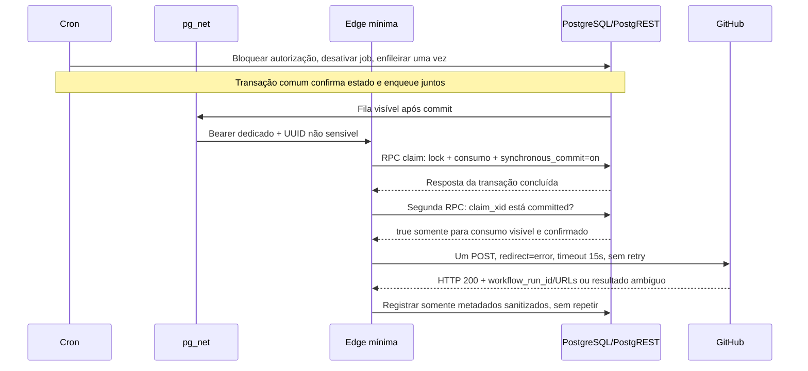

# Rascunho: CRON_CONTROLLED_DISPATCH_SQL_PREPARATION

> **Proposta corrente: [CRON_EDGE_AUTHORIZATION_REDESIGN](redesign/README.md), YELLOW.**
> Decisão humana exige prova da origem Cron. Wake-only não pode consumir.
> SQL privado/handler novos preparados offline; verificador real e identidade DB
> ainda pendentes. Nenhum entrypoint ou DDL liberado para implantação. Os textos
> e scripts anteriores abaixo permanecem como histórico, não instrução vigente.

> **Revisão vigente: CRON_STAGING_INACTIVE_PREPARATION_REVIEW — YELLOW.**
> A integração abaixo NÃO está aprovada para implantação, nem inativa.
> As premissas de ACL pg_net e bearer reutilizável foram rejeitadas.
> [Auditoria integral e correções pendentes](REVIEW.md) prevalece sobre o texto
> histórico abaixo. Scripts operacionais 10–50 e entrypoint Edge estão bloqueados
> explicitamente. O rollback 70 continua separado e não foi executado.
> Somente o [probe isolado](probe/README.md) está preparado para próxima aprovação;
> ele não depende destes oito SQLs, de Edge, Vault, pg_net ou pg_cron.

**YELLOW. Preparado para revisão humana; NÃO aplicar, implantar ou disparar.**
Nenhum SQL foi executado, inclusive para testes. Não instalar extensões, criar
jobs, criar PAT, gravar Vault ou fazer HTTP externo a partir destes arquivos.
O gate anterior `automation_remote_runner_validated` continua GREEN.

## Comparação e decisão revisada

| Opção | Transação / duplicidade | Credencial e observação | Decisão |
| --- | --- | --- | --- |
| A: Cron + http 1.6 | CALL top-level pode confirmar consumo antes do HTTP; precisa ser SECURITY INVOKER, sem SET na declaração, sem transação explícita externa ou EXCEPTION envolvendo COMMIT | http 1.6 força FOLLOWLOCATION/MAXREDIRS e não permite desligá-los na lista de curlopts; cabeçalho PAT segue para o cliente síncrono | Não escolher para este contrato sem redirects; não instalar outra versão por conveniência |
| B: Cron + pg_net direto | Um enqueue não comprova um envio: worker faz HTTP antes de confirmar remoção da fila; falha pode provocar repetição | PAT ficaria no header da fila net; ACL padrão é ampla; resposta/fila unlogged não são auditoria durável | Rejeitado para chamar GitHub diretamente |
| C: Cron + pg_net + Edge mínima | Enqueue pode repetir a entrega à Edge; a claim persistida só pode ser ganha uma vez; confirmação em segunda RPC precede GitHub | PAT somente no secret store da Edge; fila tem apenas credencial dedicada de gatilho, protegida por ACL | Recomendado neste rascunho; exige revisão e prova futura do commit RPC |

A revisão do código pg_cron 1.6.4 confirmou PQsendQuery do comando isolado no
caminho libpq. PostgreSQL permite COMMIT no CALL top-level sob as condições da
opção A; não há COMMIT permitido dentro de uma função SECURITY DEFINER. Assim,
não confundir as restrições da função com impossibilidade geral do procedimento.
O obstáculo que mudou a escolha foi o comportamento real do http 1.6.

## Fluxo proposto e barreira persistida



`cron_claim_dispatch` é VOLATILE e executa numa transação RPC normal. Não há
COMMIT interno nem HTTP nessa função. Uma resposta de claim não basta: a Edge
exige uma segunda transação observando `pg_xact_status(claim_xid)='committed'`.
Isso também bloqueia uma configuração PostgREST de rollback ou uma resposta
sem consumo durável. Não enviar `Prefer: tx=rollback`; um retorno que declare
essa preferência é recusado. O probe descrito abaixo deve comprovar o caminho
real depois da revisão e implantação, antes de armar qualquer job.

Concorrência é resolvida por lock da linha e `claim_count IN (0,1)`. O UUID da
claim e seu xid não podem ser reescritos após consumo; nenhuma rotina rearma a
autorização. Concurrency do Actions é só serialização, não deduplicação.

Garantia sob essas premissas: **no máximo uma chamada de aplicação ao endpoint
GitHub por autorização**. Aceita-se perda do disparo se ocorrer falha após o
consumo. Não afirmar exactly-once de rede, disponibilidade de terceiro, ausência
de retransmissão interna de transportes, ou segurança após restaurar estado
antigo/rearmar manualmente. Administradores da plataforma continuam confiáveis.

## Falhas cobertas

| Situação | Comportamento |
| --- | --- |
| Cron repetido/entregas duplicadas pg_net | Zero novo enqueue normal; mesmo com redelivery, somente a primeira claim ganha |
| Falha antes do commit da claim | GitHub não é chamado; não há retry interno |
| Commit feito, resposta da claim perdida | Permissão consumida e possível perda do envio; nenhuma compensação automática |
| Claim não confirmada pela segunda RPC | Nenhum GitHub POST |
| Expiração antes da execução ou após a confirmação | Nenhum novo GitHub POST; autorização nunca rearmada |
| HTTP 200 com ID/URLs válidos | accepted; ainda falta acompanhar workflow e reconciliar staging |
| HTTP 200 inválido ou 204 | ambiguous; consultar GitHub existente, não reenviar |
| Timeout/falha de rede | ambiguous; consumo permanece, não reenviar |
| Erro HTTP ou redirect | Sem retry; corpo/Location não são seguidos ou registrados |
| Registro de auditoria falha após HTTP | Claim fica consumida; resposta sanitizada mantém run_id conhecido; investigar sem reenviar |
| Cancelamento antes da claim | Job inativo, claim recusada, inclusive para mensagem já enfileirada |
| Cancelamento depois da claim | Não desfaz o request em andamento; reconciliar o resultado existente |

## Privilégios e credenciais

Auditoria usada como evidência: inspeção READ ONLY do gate anterior, registrada
na ADR. Não houve nova conexão remota neste gate. Vault estava vazio, mas
service_role tinha USAGE e SELECT em `vault.decrypted_secrets`; isso não foi
presumido seguro. `00` prepara nova inspeção de metadados antes de implantação.
`20` revoga acesso direto ao Vault/net/controle privado para PUBLIC, anon,
authenticated e service_role e falha se permanecer acesso efetivo, inclusive
por grants em colunas/herança. Revisar dependências antes de aplicar revogações.
Não alterar as sete GitHub Secrets.

As RPCs públicas têm nomes fixos, SECURITY DEFINER, owner postgres,
search_path=pg_catalog e objetos privados sempre qualificados. Somente
service_role recebe EXECUTE nas RPCs limitadas; não recebe acesso às tabelas
privadas, fila ou Vault. O invocador Cron só precisa do wrapper privado, sem
credencial ou comando arbitrário. DDL continua restrito ao administrador.
As RPCs não retornam credenciais. Uma service_role comprometida pode causar
negação de serviço consumindo uma claim; não obtém o PAT por essas RPCs.

Credenciais futuras, ambas criadas/inseridas manualmente após aprovação:

1. PAT GitHub granular, um único repositório, Actions: write e Metadata inerente,
   validade proposta de um dia. Essa permissão permite outras operações de
   Actions/workflows do repo, não apenas scheduled-sync.yml/dev. Armazenar
   **somente no secret store da Edge**, chave GITHUB_DISPATCH_PAT. Não usar PAT
   Supabase nem a credencial pessoal atual da CLI GitHub.
2. Credencial aleatória dedicada ao gatilho, 32 bytes de entropia codificados
   em exatamente 64 caracteres hexadecimais minúsculos. Mesmo valor no formulário seguro
   Vault (nome cron_dispatch_edge_trigger) e no secret store Edge
   (CRON_TRIGGER_SECRET). Não gerar nesta preparação. A fila contém esse valor
   transitoriamente; revisar as ACLs antes de inseri-lo. Não usar service_role
   como Bearer da fila. O wrapper recusa outros formatos, incluindo PAT GitHub,
   antes de enfileirar. Nenhum PAT GitHub passa pela fila.

A Edge usa SUPABASE_SERVICE_ROLE_KEY já fornecida pelo ambiente da plataforma
para RPCs internas; não criar uma chave nova. Essa chave é ampla e bypassa RLS;
ela não ganha acesso ao Vault por causa das RPCs limitadas. O secret store é
uma fronteira de confiança do projeto Edge, não isolamento exclusivo desta
função: revisar outras funções e quem pode ler/implantar código antes de inserir
o PAT. CRON_STAGING_PROJECT_REF é
metadado aprovado. SUPABASE_URL deve coincidir com essa referência. Configurar
verify_jwt=false **apenas nesta função** para aceitar o gatilho dedicado,
com a autenticação HMAC/comparação Web Crypto do handler sempre habilitada.
Endpoint publicamente alcançável não significa endpoint sem autenticação.
Planejar implantação administrativa pelo Dashboard, sem gerar PAT de
gerenciamento Supabase ou reabrir a autenticação dos Legacy revogados.
Não usar SQL Editor, prompts, argumentos CLI, arquivos ou logs para inserir
valores. Não habilitar verbose/registro de parâmetros de credenciais.

## Arquivos e ordem futura — sem executá-los nesta fase

| Arquivo | Escopo futuro |
| --- | --- |
| sql/00_inspect_readonly.sql | Metadados, privilégios e baseline, sem secrets |
| sql/10_extensions.draft.sql | Instalar somente pg_cron/pg_net, versões revisadas |
| sql/20_private_schema_and_acl.draft.sql | ACL, controle privado, índices e proteção contra rearme |
| sql/30_routines.draft.sql | Wrapper Cron, RPCs claim/confirm/finish e probe sem rede externa |
| sql/40_configure_inactive.draft.sql | Metadados aprovados e job criado INATIVO numa única transação |
| edge/*.mjs, edge/index.ts | Componente mínimo testável, sem dependências npm ou deploy automático |
| workflow-envelope.fragment.yml | Inputs/correlação e guard de ref/SHA/attempt, sem alterar Python |
| sql/50_arm_once.draft.sql | Aprovação distinta para um único teste, NUNCA executar em lote |
| sql/60_validate_readonly.sql | Evidências permitidas, sem headers/corpos/erros brutos |
| sql/70_disable_rollback.draft.sql | Desativar, cancelar se não consumido, preservar histórico |

Nenhum script está em supabase/migrations. Nenhum arquivo altera Migration 5 ou
Analytics. Os scripts de DDL são transacionais e pedem um latch de sessão
`app.cron_sql_review=staging-reviewed`; isso é uma trava contra execução
acidental, **não autenticação nem comprovação de que a conexão é staging**.
O operador deve primeiro validar a conexão staging autorizada com o guard e
revisar todo o SQL. Usar ON_ERROR_STOP no cliente; não executar com papel de
aplicação. Não há executor que percorra esses arquivos automaticamente.

O arquivo 40 exige GUCs não sensíveis: app.cron_project_ref,
app.cron_authorization_id (UUID escolhido pelo revisor), app.cron_expected_sha,
app.cron_not_before e app.cron_expires_at. Janela máxima de cinco minutos UTC.
Não há valor real preenchido no rascunho. Não usar GUC para segredo.
Reexecutar 40 com o mesmo UUID não rearma nem altera a autorização. Outro job
com o mesmo nome provoca bloqueio. Scripts de setup podem ser reavaliados
idempotentemente, mas nunca durante um teste em curso. Armamento é ação única,
não uma reconciliação que reativa jobs automaticamente.

Após instalar as rotinas e configurar o controle INATIVO, testar **somente com
nova autorização humana** duas chamadas RPC separadas, sem GitHub: primeira
cron_record_commit_probe com UUID novo, segunda cron_check_commit_probe. A segunda deve
observar committed. Verificar também rollback deliberado em ambiente local
isolado, sob autorização, antes de usar o transporte real. Não houve probe SQL
ou chamada RPC nesta fase. 50 exige o UUID desse probe; depois revoga seu
EXECUTE de service_role. Não aceitar mocks como prova dessa implantação.

Antes de 50: Edge e fragmento do workflow revisados/publicados pelo humano,
credenciais coincidentes e isoladas, HEAD aprovado, nenhuma execução concorrente,
dry-selection oficial com uma demo due, baseline READ ONLY atualizado, operador
acompanhando e capacidade de desativação preparada. Além das condições SQL,
50 exige `app.cron_activation_review=one-cron-test-reviewed` e app.cron_probe_id.
O teste usa janela curta; primeira invocação desativa o job, antes da entrega
assíncrona. Expiração ou autorização consumida impedem novo GitHub dispatch
mesmo se um job permanecer agendado. Não encerrar sem comprovar active=false.

## Correlação e reconciliação

UUID da autorização -> jobid/pid/horários Cron -> net_request_id -> claim_id/xid
confirmado -> HTTP status -> workflow_run_id. A Edge valida URLs oficiais do
mesmo repositório e guarda só o ID numérico; links podem ser reconstruídos.
Inputs dispatch_id/expected_sha e run-name identificam um eventual run em caso
de resposta perdida. O guard anterior às secrets bloqueia ref diferente de dev,
SHA diferente e run_attempt>1. A alteração real do workflow não foi aplicada.

O observador acompanha somente esse run_id (runner, guard, dispatcher, contadores
e statuses individuais) e reconcilia staging READ ONLY. HTTP 200 não comprova
sincronização concluída. Comparar baseline, runs novas, eventos e estado da demo;
no_changes é válido. Se uma resposta for ambígua, procurar primeiro runs
existentes por UUID/título, ref/SHA/horário. Nunca repetir POST para descobrir.

Rollback: 70 desativa e cancela autorização ainda não consumida. Não desfaz
dispatch aceito, não apaga fila/histórico/tabelas e não usa DROP EXTENSION ou
DELETE. Depois, desabilitar a rota Edge e revogar manualmente o PAT dedicado,
sob autorização. A revogação de ACL não será revertida restaurando grants
amplos de leitura de segredos. Guardar evidências sanitizadas.

## Testes e limites de evidência

Executar offline, sem SQL ou HTTP real:

```powershell
node --test tests/cron_dispatch/dispatch.test.mjs
.venv/Scripts/python.exe -m unittest discover -s tests/unit -p test_cron_dispatch_drafts.py -v
```

Os testes executam o mesmo handler/RPC adapter do rascunho com fetch e ledger
mockados. Cobrem concorrência/replay, expiração, consumo antes de envio,
confirmação de commit, falhas, respostas ambíguas, ref e ausência de leaks.
Os testes Python são contratos estáticos de segurança dos arquivos SQL, não
um parser PostgreSQL nem uma prova de comportamento do banco.
Docker não está acessível nesta sessão; de todo modo, a autorização proíbe
aplicar SQL. Não alegar validação de sintaxe/semântica SQL em servidor, ACLs
implantadas, atomicidade real do PostgreSQL, ou execução Deno/Supabase com base
em mocks Node. Essas verificações permanecem pendentes de revisão/autorização.

## Custos e risco

Uma Edge Function no mesmo staging adiciona uma invocação pequena e secret
store já oferecidos pela plataforma; nenhuma nova dependência de produção ou
plataforma paga foi instalada. Consome quotas de Edge Functions, CPU/egress e
banco do Free; consultar saldo/plano antes de implantar. Free limita a função
a 150 segundos de duração e 2 segundos de CPU; o trabalho proposto é I/O curto,
com RPCs de até 5s e GitHub de até 15s. Não assumir custo adicional zero se a
quota já estiver esgotada. Pausa/inatividade do projeto impede Cron funcionar.
O runner padrão GitHub permanece gratuito para o repositório público.

Risco MEDIUM: desenho e lógica offline preparados, mas SQL/PostgREST/Deno,
privilégios, deploy, credenciais e teste Cron real continuam não validados.
Próxima aprovação: revisão humana dos rascunhos e autorização de implantação
INATIVA/isolamento e probe sem dispatch. Criar credenciais e armar o teste
exigem aprovações distintas. Este pacote não autoriza nenhuma delas.

Fontes primárias, consultadas em 19/10/2026:

- [PostgreSQL transactions](https://www.postgresql.org/docs/current/plpgsql-transactions.html)
- [CREATE PROCEDURE restrictions](https://www.postgresql.org/docs/current/sql-createprocedure.html)
- [pg_cron 1.6.4 source](https://github.com/citusdata/pg_cron/blob/v1.6.4/src/pg_cron.c)
- [http 1.6 curl behavior](https://github.com/pramsey/pgsql-http/blob/v1.6.0/http.c)
- [pg_net permissions](https://supabase.com/docs/guides/database/extensions/pg_net#permissions)
- [PostgREST transaction end](https://docs.postgrest.org/en/stable/references/transactions.html)
- [GitHub REST dispatch](https://docs.github.com/en/rest/actions/workflows#create-a-workflow-dispatch-event)
- [run details response](https://github.blog/changelog/2026-02-19-workflow-dispatch-api-now-returns-run-ids/)
- [Edge secrets](https://supabase.com/docs/guides/functions/secrets)
- [Edge limits](https://supabase.com/docs/guides/functions/limits)
